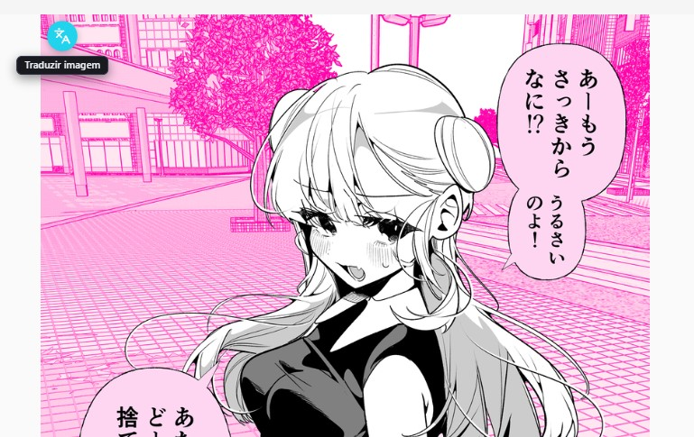
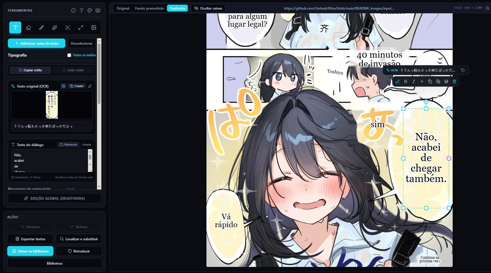
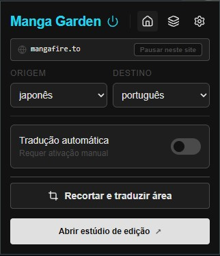
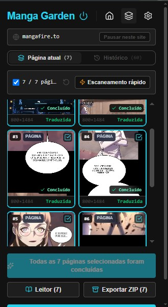
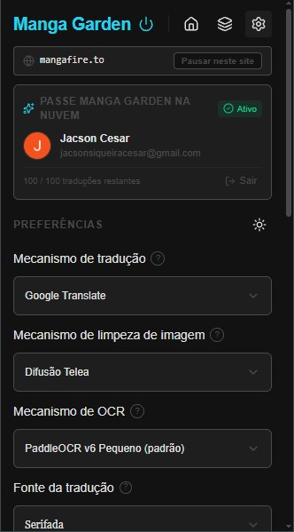

<div align="center">

[Português (Brasil)](README.md) | [English](README.en.md) | [Español](README.es.md) | [简体中文](README.zh-CN.md) | [Tiếng Việt](README.vi.md) | [日本語](README.ja.md)

# 🪁 Manga Garden

### Read manga in your language, right in your browser.
**No Python • No self-hosted servers • AI translation in your browser**

🌐 **[Visit the Manga Garden website](https://manga-garden-translator.pages.dev/)**

<br/>

[](./README_images/Gemini_Generated_Image_f7lh52f7lh52f7lh.jpeg)

</div>

<div align="center">
  <p><strong>Special thanks to the <a href="https://github.com/Unheat/Kites">Kites</a> project, the <a href="https://github.com/Unheat">Unheat</a> team, and its contributors.</strong><br />Kites' open-source work served as the foundation for Manga Garden; this acknowledgment recognizes the inspiration and contributions of the original project.</p>
</div>

---

## 💡 Why Manga Garden?

Traditional manga translators require installing complex Python scripts and gigabytes of CUDA packages, or sending your reading history to third-party servers.

**Manga Garden changes that.** It is a lightweight Chrome extension that runs modern vision and language models **directly on your graphics card using WebGPU**.

- ⚡ **Easy installation:** install the extension and start reading. To run the project from source, follow the installation guide below.
- 🔒 **Local processing whenever possible:** text recognition (OCR) and background cleanup run on your device. Images are not sent to the translation provider; recognized text may be sent to the translation service you choose.
- 🎨 **Smart background restoration:** AI inpainting removes the original text while preserving line art, screentones, and textures.
- ✍️ **Natural typesetting:** measures speech bubbles, balances line breaks, adjusts font size, and adapts text colors.
- 🗨️ **Smart bubble fitting:** heuristic detection and neural YOLO expand narrow reading areas to avoid excessively small fonts.
- 📜 **Long webtoon support:** translates strips over 14,000 px by processing in-memory tiles without reducing the original resolution.
- 🛠️ **Built-in studio:** correct translations, resize bubbles, and adjust typography.

---

## 🖼️ See it in action

### Japanese → Portuguese
> *Source: [Pixiv illustration #144884723](https://www.pixiv.net/en/artworks/144884723)*

<div align="center">
<table>
  <tr>
    <th width="50%" align="center">Original in Japanese</th>
    <th width="50%" align="center">Translated by Manga Garden</th>
  </tr>
  <tr>
    <td align="center">
      
    </td>
    <td align="center">
      
    </td>
  </tr>
</table>
</div>

### Japanese → English
> *Story: 佐藤さんは知っていた, by [@09ra_19ra](https://x.com/09ra_19ra)*

<div align="center">
<table>
  <tr>
    <th width="50%" align="center">Original in Japanese</th>
    <th width="50%" align="center">Translated by Manga Garden</th>
  </tr>
  <tr>
    <td align="center">
      
    </td>
    <td align="center">
      
    </td>
  </tr>
</table>
</div>

### Japanese → Vietnamese
> *Source: [Pixiv illustration #145272482](https://www.pixiv.net/en/artworks/145272482)*

<div align="center">
<table>
  <tr>
    <th width="50%" align="center">Original in Japanese</th>
    <th width="50%" align="center">Translated by Manga Garden</th>
  </tr>
  <tr>
    <td align="center">
      
    </td>
    <td align="center">
      
    </td>
  </tr>
</table>
</div>

---

## 🖱️ Instant in-page translation

Hover over any comic image on Twitter/X, Pixiv, or manga reader sites. A discreet button appears next to the image; click it to translate the dialogue right on the page, without copying and pasting.

<div align="center">
  
</div>

- 🖱️ **Hover button:** translate an image instantly.
- 📌 **Persistent pins:** keep translation buttons visible on images.
- 🚀 **Auto-translate:** translate new images as you browse the page.
- ✂️ **Screen crop:** translate protected canvas elements, WebGL games, or selected areas using the right-click menu or `Ctrl/Alt + Shift + X`.
- ⚡ **Reading shortcuts:** press `F` to view the original image, `Ctrl/Alt + Shift + Z` to translate the image under the cursor, and `Ctrl/Alt + Shift + M` to open the chapter reader.
- 🎯 **Right-click menu:** translate web images from the browser context menu.

---

## 📖 Chapter reader and fast scan

Read entire manga or webtoon chapters in a distraction-free view, with automatic page detection, continuous vertical mode, batch translation, and ZIP export for offline reading:

[](./site/assets/reader.jpg)

- **Fast scan:** automatically scans the page and queues images loaded on demand.
- **Flexible modes:** switch between continuous vertical strips, single-page, and two-page layouts.
- **Batch translation:** translate the entire chapter with one click and track progress.
- **ZIP export:** bundle translated pages into a numbered file for offline reading.

---

## 🛠️ Built-in Manga Garden Studio

Want to review a translation or adjust the text? Open **Manga Garden Studio** in full screen from the extension.

[](./site/assets/studio-editor.jpg)

- **Direct editing:** double-click a bubble to edit dialogue in place, with real-time typesetting.
- **Interactive canvas:** drag and resize bubbles using eight-point handles.
- **AI inpainting brush:** precisely remove imperfections, bubbles, or untranslated sound effects with brush strokes.
- **Side-by-side comparison:** compare the original, cleaned, and typeset versions.
- **Typography controls:** adjust fonts, colors, alignment, and line spacing.
- **Export:** download translated and cleaned pages at their original resolution.

---

## 🎛️ Extension controls and presets

Customize the target language, OCR models, and inpainting algorithms from the extension panel:

<div align="center">
<table>
  <tr>
    <th width="33%" align="center">Control panel</th>
    <th width="33%" align="center">Chapter reader and scanner</th>
    <th width="34%" align="center">Engine settings</th>
  </tr>
  <tr>
    <td align="center">
      
    </td>
    <td align="center">
      
    </td>
    <td align="center">
      
    </td>
  </tr>
</table>
</div>

- **Custom glossary:** define character names, honorifics, and specialized terms to guide local and cloud models.
- **Per-site rules:** enable, disable, or configure element selectors for each domain.

---

## 🧠 Modern AI

| Component | Options | Description |
| :--- | :--- | :--- |
| **Translation** | **WebLLM** *(local WebGPU)*<br/>**Shared cloud pool** *(100/day)*<br/>**Google Translate**<br/>**Custom API** *(OpenAI, Claude, Gemini)* | Run local models (Qwen 3.5, Qwen 3, Gemma 3, Llama 3.2), use Google Translate, access the shared pool, or connect your own API key. |
| **Inpainting** | **LaMa Manga** *(neural)*<br/>**AOT-GAN** *(fast neural)*<br/>**Telea diffusion** *(instant)*<br/>**Simple inpainting** | Removes text within character boundaries to preserve the artwork. |
| **OCR** | **PaddleOCR v3 – v6** | Multilingual text detection and recognition, including long webtoon strips. |
| **Bubble fitting** | **Neural YOLO** *(WebGPU)*<br/>**Heuristic** *(instant)*<br/>**Classic MST** | Expands dialogue space inside bubbles to avoid very small fonts. |

---

### Option 2: ZIP file

1. Download the ZIP from the repository's [releases page](https://github.com/jacosncesar/MangaLumeTwo/releases/latest) when a Manga Garden version is published.
2. Extract the `.zip` and load the folder in Chrome from `chrome://extensions/` > **Developer mode** > **Load unpacked**.

### Option 3: build from source

```bash
# 1. Clone the repository into a local folder named manga-garden
git clone https://github.com/jacosncesar/MangaLumeTwo.git manga-garden
cd manga-garden

# 2. Install dependencies and build the extension
npm ci
npm run build
```

1. In Chrome, open `chrome://extensions/`.
2. Enable **Developer mode**.
3. Click **Load unpacked** and select the generated `dist/` folder.
4. Pin the extension to the browser toolbar.

---

## 🤝 Contributions and documentation

Contributions from developers, translators, and readers are welcome.

- 📖 **[Documentation center](docs/README.md)** — architecture diagrams, pipeline specifications, and runtime contracts.
- 📐 **[Interactive pipeline map](docs/workflow.html)** — interactive view of the detection, inpainting, and typesetting stages.
- 🛠️ **[Contribution guide](CONTRIBUTING.md)** — environment setup, running tests, and submitting contributions.

---

## 📜 License and acknowledgments

This project is distributed under the **[GNU General Public License, version 3 or any later version](LICENSE)**.

Manga Garden is an independent modified work based on [Kites](https://github.com/Unheat/Kites), a project developed by [Unheat](https://github.com/Unheat). Manga Garden is not affiliated with, sponsored by, or endorsed by Unheat. Its name, visual identity, interface, and modifications are distinct from the original project.

**Modification notice:** Manga Garden's public development history begins on **2026-07-08**. Changes for each version are recorded in the repository history and corresponding tags.

**Source code for published versions:**
- [v1.2.4 — corresponding source code](https://github.com/jacosncesar/manga-garden/tree/v1.2.4) (published 2026-11-12 UTC). The ZIP contains `LICENSE` and `NOTICE.txt`, but not `THIRD_PARTY_NOTICES.md`; this was corrected in the next package, which has not yet been published.
- [v1.2.3 — corresponding source code](https://github.com/jacosncesar/manga-garden/tree/v1.2.3) (published 2026-11-11). The ZIP was published before `LICENSE` and `NOTICE.txt` were included; this version has been superseded.

The tags linked above let you inspect and download the source code corresponding to those versions. New versions should be published with their source-code tag and the relevant license notices included in the ZIP.

This project thanks the open-source initiatives that made its development possible:
- **[manga-image-translator (Cotrans)](https://github.com/zyddnys/manga-image-translator):** spatial text-grouping and typesetting algorithms.
- **[xianscan-rust](https://github.com/ArbenApura/xianscan-rust):** dynamic-patch inpainting architectures and OCR noise filters.
- **[PaddleOCR](https://github.com/PaddlePaddle/PaddleOCR):** high-speed text detection models.
- **[@mlc-ai/web-llm](https://github.com/mlc-ai/web-llm):** browser-native WebGPU runtime for large language models.
- Special thanks to [**Unheat** and An Dang](https://github.com/Unheat).

---

<div align="center">
  <sub>Made with ❤️ for everyone who enjoys manga and comics.</sub>
</div>
