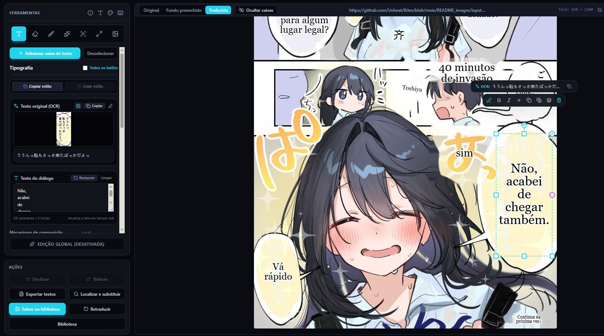

<div align="center">

[Português (Brasil)](README.md) | [Español](README.es.md) | [简体中文](README.zh-CN.md) | [Tiếng Việt](README.vi.md) | [日本語](README.ja.md)

# 🪁 Manga Garden

### Lee manga en tu idioma, directamente en el navegador.
**Sin Python • Sin servidores propios • Traducción con IA en el navegador**

🌐 **[Visita el sitio web de Manga Garden](https://manga-garden-translator.pages.dev/)**

<br/>

[](./README_images/Gemini_Generated_Image_f7lh52f7lh52f7lh.jpeg)

</div>

<div align="center">
  <p><strong>Agradecemos especialmente al proyecto <a href="https://github.com/Unheat/Kites">Kites</a>, al equipo de <a href="https://github.com/Unheat">Unheat</a> y a todas las personas colaboradoras.</strong><br />El trabajo de código abierto de Kites sirvió de base para Manga Garden; este agradecimiento reconoce la inspiración y las contribuciones del proyecto original.</p>
</div>

---

## 💡 ¿Por qué Manga Garden?

Los traductores tradicionales de manga requieren instalar complejos scripts de Python y gigabytes de paquetes CUDA, o enviar el historial de lectura a servidores de terceros.

**Manga Garden cambia eso.** Es una extensión ligera para Chrome que ejecuta modelos modernos de visión y lenguaje **directamente en la tarjeta gráfica mediante WebGPU**.

- ⚡ **Instalación sencilla:** instala la extensión y empieza a leer. Para ejecutar el proyecto desde el código fuente, sigue la guía de instalación de abajo.
- 🔒 **Procesamiento local cuando es posible:** el reconocimiento de texto (OCR) y la limpieza del fondo se realizan en el dispositivo. La imagen no se envía al proveedor de traducción; el texto reconocido puede enviarse al servicio de traducción que elijas.
- 🎨 **Restauración inteligente del fondo:** el relleno con IA elimina el texto original y conserva trazos, tramas y texturas.
- ✍️ **Composición natural:** mide los globos, equilibra los saltos de línea, ajusta el tamaño de fuente y adapta los colores.
- 🗨️ **Ajuste inteligente de globos:** la detección heurística y YOLO neuronal amplían las zonas de lectura estrechas para evitar que la fuente quede demasiado pequeña.
- 📜 **Compatibilidad con webtoons largos:** traduce tiras de más de 14.000 px mediante división en bloques en memoria, sin reducir la resolución original.
- 🛠️ **Estudio integrado:** corrige traducciones, cambia el tamaño de los globos y ajusta la tipografía.

---

## 🖼️ Mira cómo funciona

### Japonés → portugués
> *Fuente: [ilustración en Pixiv #144884723](https://www.pixiv.net/en/artworks/144884723)*

<div align="center">
<table>
  <tr>
    <th width="50%" align="center">Original en japonés</th>
    <th width="50%" align="center">Traducido por Manga Garden</th>
  </tr>
  <tr>
    <td align="center"></td>
    <td align="center"></td>
  </tr>
</table>
</div>

### Japonés → inglés
> *Historia: 佐藤さんは知っていた, de [@09ra_19ra](https://x.com/09ra_19ra)*

<div align="center">
<table>
  <tr>
    <th width="50%" align="center">Original en japonés</th>
    <th width="50%" align="center">Traducido por Manga Garden</th>
  </tr>
  <tr>
    <td align="center"></td>
    <td align="center"></td>
  </tr>
</table>
</div>

### Japonés → vietnamita
> *Fuente: [ilustración en Pixiv #145272482](https://www.pixiv.net/en/artworks/145272482)*

<div align="center">
<table>
  <tr>
    <th width="50%" align="center">Original en japonés</th>
    <th width="50%" align="center">Traducido por Manga Garden</th>
  </tr>
  <tr>
    <td align="center"></td>
    <td align="center"></td>
  </tr>
</table>
</div>

---

## 🖱️ Traducción instantánea en la página

Pasa el cursor sobre cualquier imagen de cómic en Twitter/X, Pixiv o sitios de manga. Aparecerá un botón discreto junto a la imagen; haz clic para traducir el diálogo directamente en la página, sin copiar ni pegar.

<div align="center">
  
</div>

- 🖱️ **Al pasar el cursor:** traduce una imagen al instante.
- 📌 **Botones persistentes:** mantén visibles los botones de traducción en las imágenes.
- 🚀 **Traducción automática:** traduce imágenes nuevas mientras recorres la página.
- ✂️ **Recorte de pantalla:** traduce elementos canvas protegidos, juegos WebGL o áreas seleccionadas desde el menú contextual o con `Ctrl/Alt + Shift + X`.
- ⚡ **Atajos de lectura:** pulsa `F` para ver la imagen original, `Ctrl/Alt + Shift + Z` para traducir la imagen bajo el cursor y `Ctrl/Alt + Shift + M` para abrir el lector de capítulos.
- 🎯 **Clic derecho:** traduce imágenes web desde el menú contextual del navegador.

---

## 📖 Lector de capítulos y escaneo rápido

Lee capítulos completos de manga o webtoon en una vista sin distracciones, con detección automática de páginas, modo vertical continuo, traducción por lotes y exportación ZIP para leer sin conexión:

[](./site/assets/reader.jpg)

- **Escaneo rápido:** recorre la página automáticamente y añade a la cola imágenes cargadas bajo demanda.
- **Modos flexibles:** alterna entre tiras verticales continuas, página única y página doble.
- **Traducción por lotes:** traduce el capítulo completo con un clic y consulta el progreso.
- **Exportación ZIP:** reúne las páginas traducidas en un archivo numerado para leer sin conexión.

---

## 🛠️ Estudio integrado de Manga Garden

¿Quieres revisar una traducción o ajustar el texto? Abre el **Estudio de Manga Garden** en pantalla completa desde la extensión.

[](./site/assets/studio-editor.jpg)

- **Edición directa:** haz doble clic en un globo para editar el diálogo en el mismo lugar, con ajuste tipográfico en tiempo real.
- **Lienzo interactivo:** arrastra y cambia el tamaño de los globos con controles de ocho puntos.
- **Pincel de restauración con IA:** elimina imperfecciones, globos o efectos de sonido sin traducir con pinceladas precisas.
- **Comparación lado a lado:** compara las versiones original, limpia y compuesta.
- **Control tipográfico:** ajusta la fuente, los colores, la alineación y el interlineado.
- **Exportación:** descarga páginas traducidas y limpias en su resolución original.

---

## 🎛️ Controles y ajustes preestablecidos de la extensión

Personaliza el idioma de destino, los modelos OCR y los algoritmos de relleno desde el panel de la extensión:

<div align="center">
<table>
  <tr>
    <th width="33%" align="center">Panel de control</th>
    <th width="33%" align="center">Lector y escáner de capítulos</th>
    <th width="34%" align="center">Ajustes de los motores</th>
  </tr>
  <tr>
    <td align="center"></td>
    <td align="center"></td>
    <td align="center"></td>
  </tr>
</table>
</div>

- **Glosario personalizado:** define nombres de personajes, honoríficos y términos específicos para orientar los modelos locales y en la nube.
- **Reglas por sitio:** activa, desactiva o configura selectores de elementos para cada dominio.

---

## 🧠 IA moderna

| Componente | Opciones | Descripción |
| :--- | :--- | :--- |
| **Traducción** | **WebLLM** *(WebGPU local)*<br/>**Grupo compartido en la nube** *(100 al día)*<br/>**Google Translate**<br/>**API personalizada** *(OpenAI, Claude, Gemini)* | Ejecuta modelos locales (Qwen 3.5, Qwen 3, Gemma 3, Llama 3.2), usa Google Translate, accede al grupo compartido o conecta tu propia clave API. |
| **Relleno** | **LaMa Manga** *(neuronal)*<br/>**AOT-GAN** *(neuronal rápido)*<br/>**Difusión de Telea** *(instantánea)*<br/>**Relleno simple** | Elimina texto dentro de los límites de los caracteres para preservar la ilustración. |
| **OCR** | **PaddleOCR v3 – v6** | Detección y reconocimiento multilingüe de texto, incluidas tiras largas de webtoon. |
| **Ajuste de globos** | **YOLO neuronal** *(WebGPU)*<br/>**Heurístico** *(instantáneo)*<br/>**MST clásico** | Amplía el espacio para el diálogo dentro de los globos y evita fuentes demasiado pequeñas. |

---

### Opción 2: archivo ZIP

1. Descarga el archivo ZIP desde la página de [versiones del repositorio](https://github.com/jacosncesar/manga-garden/releases/latest) cuando se publique una versión de Manga Garden.
2. Descomprime el `.zip` y carga la carpeta en Chrome desde `chrome://extensions/` > **Modo de desarrollador** > **Cargar descomprimida**.

### Opción 3: compilar desde el código fuente

```bash
# 1. Clona el repositorio
git clone https://github.com/jacosncesar/MangaLumeTwo.git manga-garden
cd manga-garden

# 2. Instala las dependencias y compila la extensión
npm ci
npm run build
```

1. En Chrome, abre `chrome://extensions/`.
2. Activa el **Modo de desarrollador**.
3. Haz clic en **Cargar descomprimida** y selecciona la carpeta `dist/` generada.
4. Fija la extensión en la barra del navegador.

---

## 🤝 Contribuciones y documentación

Las contribuciones de desarrolladores, traductores y lectores son bienvenidas.

- 📖 **[Centro de documentación](docs/README.md)** — diagramas de arquitectura, especificaciones del flujo y contratos de ejecución.
- 📐 **[Mapa interactivo del flujo](docs/workflow.html)** — visualización de las etapas de detección, relleno y composición.
- 🛠️ **[Guía de contribución](CONTRIBUTING.md)** — configuración del entorno, ejecución de pruebas y envío de contribuciones.

---

## 📜 Licencia y agradecimientos

Este proyecto se distribuye bajo la **[Licencia Pública General de GNU, versión 3 o cualquier versión posterior](LICENSE)**.

Manga Garden es un proyecto independiente y modificado, basado en [Kites](https://github.com/Unheat/Kites), desarrollado por [Unheat](https://github.com/Unheat). Manga Garden no está afiliado, patrocinado ni respaldado por Unheat. Su nombre, identidad visual, interfaz y modificaciones son distintos del proyecto original.

**Aviso de modificaciones:** el historial público de desarrollo de Manga Garden está registrado desde **2026-07-08**. Los cambios de cada versión constan en el historial del repositorio y en sus etiquetas correspondientes.

**Código fuente de las versiones publicadas:**
- [v1.2.4 — código fuente correspondiente](https://github.com/jacosncesar/manga-garden/tree/v1.2.4) (publicada el 2026-11-12 UTC). El ZIP contiene `LICENSE` y `NOTICE.txt`, pero no incluye `THIRD_PARTY_NOTICES.md`; la omisión se corrigió en el siguiente paquete, aún no publicado.
- [v1.2.3 — código fuente correspondiente](https://github.com/jacosncesar/manga-garden/tree/v1.2.3) (publicada el 2026-11-11). El ZIP se publicó antes de añadir `LICENSE` y `NOTICE.txt`; esta versión ha sido sustituida.

Las etiquetas anteriores permiten consultar y descargar el código fuente correspondiente a esas versiones. Las nuevas versiones deben publicarse con su etiqueta de código fuente y los avisos de licencia pertinentes incluidos en el ZIP.

Este proyecto agradece a las iniciativas de código abierto que hicieron posible su desarrollo:
- **[manga-image-translator (Cotrans)](https://github.com/zyddnys/manga-image-translator):** algoritmos de agrupación espacial de texto y composición tipográfica.
- **[xianscan-rust](https://github.com/ArbenApura/xianscan-rust):** arquitecturas de restauración por bloques dinámicos y filtros de ruido OCR.
- **[PaddleOCR](https://github.com/PaddlePaddle/PaddleOCR):** modelos de detección de texto de alta velocidad.
- **[@mlc-ai/web-llm](https://github.com/mlc-ai/web-llm):** entorno WebGPU nativo del navegador para modelos de lenguaje.
- Agradecimiento especial a [**Unheat** y An Dang](https://github.com/Unheat).

---

<div align="center">
  <sub>Hecho con ❤️ para quienes disfrutan del manga y los cómics.</sub>
</div>
