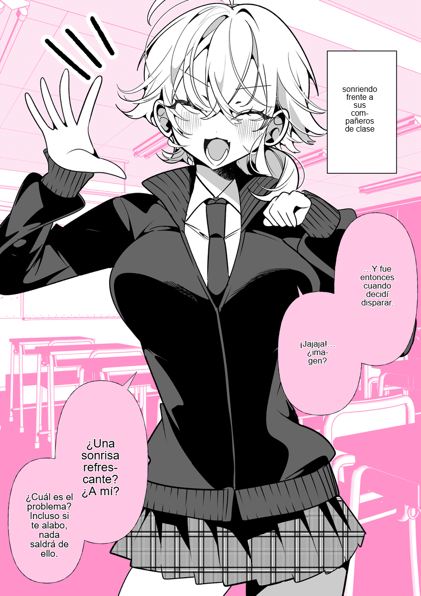

<div align="center">

[Português (Brasil)](README.md) | [English](README.en.md) | [Español](README.es.md) | [简体中文](README.zh-CN.md) | [Tiếng Việt](README.vi.md) | [日本語](README.ja.md)

# 🪁 Manga Garden

### どんな言語のマンガも、ブラウザ上でそのまま読める。
**Python不要 • 専用サーバー不要 • ブラウザー内で動作するAI翻訳**

🌐 **[Manga Garden のウェブサイト](https://manga-garden-translator.pages.dev/)**

<br/>

[](./README_images/Gemini_Generated_Image_f7lh52f7lh52f7lh.jpeg)

</div>

<div align="center">
  <p><strong>プロジェクト <a href="https://github.com/Unheat/Kites">Kites</a>、チーム <a href="https://github.com/Unheat">Unheat</a>、および貢献者の皆さまに心より感謝します。</strong><br />Kites のオープンソースの成果が Manga Garden の基盤となりました。これは原作プロジェクトの着想と貢献への謝意です。</p>
</div>

---

## 💡 なぜ Manga Garden なのか？

従来のマンガ翻訳ツールは、複雑な Python 環境の構築やギガバイト単位の CUDA パッケージの導入が必要だったり、個人の閲覧履歴を外部クラウドサーバーにアップロードする必要がありました。

**Manga Garden はそれを一変させます。** 最先端の画像認識および大規模言語モデルを、**WebGPU 経由でお使いの GPU 上で直接実行**する軽量な Chrome 拡張機能です。

- ⚡ **簡単なインストール：** 拡張機能をインストールしてすぐに読書を始められます。ソースコードから実行する場合は、以下の手順に従ってください。
- 🔒 **可能な範囲でローカル処理：** OCR と背景の消去は端末上で実行されます。画像は翻訳プロバイダーへ送信されませんが、認識されたテキストは選択した翻訳サービスへ送信される場合があります。
- 🎨 **インテリジェントな背景修復：** AI インペインティングで元の文字を消しながら、線画、スクリーントーン、質感を保ちます。
- ✍️ **自然な文字組み：** 吹き出しを計測し、改行、フォントサイズ、色を調整します。
- 🗨️ **吹き出しの調整：** ヒューリスティックとニューラル YOLO が狭い領域を広げ、小さすぎる文字を防ぎます。
- 📜 **長い Webtoon に対応：** 14,000 px を超える縦長画像も、元の解像度を保ったままメモリ内で分割して翻訳します。
- 🛠️ **内蔵 Studio：** 翻訳の修正、吹き出しのサイズ変更、文字組みの調整ができます。

---

## 🖼️ 実際の動作デモ

### 日本語 → ポルトガル語
> *出典: [Pixiv のイラスト #144884723](https://www.pixiv.net/en/artworks/144884723)*

<div align="center">
<table>
  <tr><th width="50%" align="center">日本語原文</th><th width="50%" align="center">Manga Garden による翻訳</th></tr>
  <tr>
    <td align="center"></td>
    <td align="center"></td>
  </tr>
</table>
</div>

### 日本語 → 英語 (Japanese → English)
> *作品: 佐藤さんは知っていた by [@09ra_19ra](https://x.com/09ra_19ra)*

<div align="center">
<table>
  <tr>
    <th width="50%" align="center">日本語原文 (Original Japanese)</th>
    <th width="50%" align="center">Manga Garden 翻訳後 (Manga Garden Translated)</th>
  </tr>
  <tr>
    <td align="center">
      
    </td>
    <td align="center">
      
    </td>
  </tr>
</table>
</div>

### 日本語 → ベトナム語 (Japanese → Vietnamese)
> *出典: [Pixiv Artwork #145272482](https://www.pixiv.net/en/artworks/145272482)*

<div align="center">
<table>
  <tr>
    <th width="50%" align="center">日本語原文 (Original Japanese)</th>
    <th width="50%" align="center">Manga Garden 翻訳後 (Manga Garden Translated)</th>
  </tr>
  <tr>
    <td align="center">
      
    </td>
    <td align="center">
      
    </td>
  </tr>
</table>
</div>

### 日本語 → スペイン語 (Japanese → Spanish)
> *出典: [Pixiv のイラスト #144216246](https://www.pixiv.net/en/artworks/144216246)*

<div align="center">
<table>
  <tr>
    <th width="50%" align="center">日本語原文</th>
    <th width="50%" align="center">Manga Garden によるスペイン語訳</th>
  </tr>
  <tr>
    <td align="center"></td>
    <td align="center"></td>
  </tr>
</table>
</div>

---

## 🖱️ ページ上での即時翻訳

Twitter/X、Pixiv、マンガサイトの画像にカーソルを合わせると、画像の近くにボタンが表示されます。クリックすると、コピー＆ペーストせずにページ上でセリフを翻訳できます。

<div align="center">
  
</div>

- 🖱️ **ホバー翻訳 (Hover)：** マンガのコマにカーソルを合わせるだけで即座に翻訳。
- 📌 **常時表示 (Persistent)：** ページ内のすべての画像に翻訳バッジを常に表示。
- 🚀 **自動翻訳 (Auto-Translate)：** ページをスクロールするだけで、画面内に現れたコマを自動検出して翻訳。
- ✂️ **画面クロップ翻訳 (Screen Crop)：** 右クリックメニューまたは `Ctrl/Alt + Shift + X` で、保護された Canvas、WebGL ゲーム、画面上の任意範囲を切り抜いて翻訳。
- ⚡ **閲覧ショートカットキー：** `F` キーで原文を瞬時にプレビュー、`Ctrl/Alt + Shift + Z` でホバー中の画像を即時翻訳、`Ctrl/Alt + Shift + M` でチャプターリーダーを素早く起動。
- 🎯 **右クリックメニュー：** ブラウザのコンテキストメニューからウェブ上のあらゆる画像をいつでも翻訳。

---

## 📖 チャプターリーダー＆高速スキャン

マンガや Webtoon の 1 話全体を、集中しやすい専用ビューで快適に読書：遅延読み込み画像の自動バッチ検出、シームレスな縦スクロール表示、複数ページの並列翻訳、オフライン ZIP エクスポートに対応：

[](./README_images/UI-feature/reader.png)

- **高速スキャン (Fast Scan)：** ページを自動スクロールしながら、遅延読み込み（lazy-load）されるコマをすべて検知して翻訳キューに追加。
- **多彩なリーダー表示：** Webtoon の連続縦スクロール、単ページ表示、見開き 2 ページ表示を自在に切り替え。
- **1 話丸ごと一括翻訳：** 進捗バー付きで 1 話全体をワンクリック翻訳。キャッシュ機能でオフラインでも安心。
- **1 クリックで ZIP 保存：** 翻訳済みの全ページを番号順に整理された ZIP ファイルとしてワンクリック保存。サーバーへのアップロードなしでオフライン保存・アーカイブが可能です。

---

## 🛠️ 内蔵 Manga Garden Studio

翻訳を推敲したり、文字配置をこだわりたいですか？ 拡張機能からフルスクリーンの **Manga Garden Studio** を直接起動できます。

[](./README_images/UI-feature/studio-editor.png)

- **インライン直接編集：** 吹き出しをダブルクリックするだけでその場でセリフを修正可能。サブピクセル単位の垂直中央揃えと自動リフローに対応。
- **直感的なキャンバス操作：** 8 点ハンドルで吹き出しの位置やサイズを自由に調整。
- **ローカル AI 修復ブラシ (Inpaint Brush)：** ブラシ操作で、画像の乱れ、吹き出し、未翻訳の描き文字（擬音・SFX）を高精度に消去。
- **ビフォーアフター比較：** 原文画像、消去後（クリーン）、写植後の各レイヤーをワンクリックで瞬時に比較切り替え。
- **タイポグラフィ調整：** フォントサイズ、文字色、配置揃え、行間をリアルタイムに調整。
- **ワンクリック高解像度出力：** 元画像の解像度を維持したまま、綺麗な翻訳画像をエクスポート。

---

## 🎛️ ポップアップ操作と設定

直感的なポップアップ画面から、翻訳先言語、ニューラル OCR モデル、背景消去アルゴリズムを自由にカスタマイズ：

<div align="center">
<table>
  <tr>
    <th width="33%" align="center">クイック操作パネル (Quick Control)</th>
    <th width="33%" align="center">チャプターリーダー＆スキャナー</th>
    <th width="34%" align="center">エンジン・モデル詳細設定</th>
  </tr>
  <tr>
    <td align="center">
      
    </td>
    <td align="center">
      
    </td>
    <td align="center">
      
    </td>
  </tr>
</table>
</div>

- **カスタム用語集 (Custom Glossary)：** キャラクター名、敬称、専門用語をあらかじめ登録し、ローカルおよびクラウド LLM の翻訳精度を向上。
- **ドメイン別ルール：** ドメインごとに CSS セレクターを個別指定したり、機能の有効/無効を設定。

---

## 🧠 最新の AI テクノロジーを搭載

| コンポーネント | 選択可能なエンジン | 説明 |
| :--- | :--- | :--- |
| **翻訳** | **WebLLM** *(ローカル WebGPU)*<br/>**クラウド共有プール** *(1日100回)*<br/>**Google 翻訳**<br/>**カスタム API** *(OpenAI, Claude, Gemini)* | ローカルモデル（Qwen 3.5、Qwen 3、Gemma 3、Llama 3.2）の実行、Google 翻訳、共有プールの利用、または独自の API キーの接続ができます。 |
| **背景修復 (Inpainting)** | **LaMa Manga** *(ニューラルモデル)*<br/>**AOT-GAN** *(高速ニューラル)*<br/>**Telea Diffusion** *(即時)*<br/>**シンプル塗りつぶし (Simple Fill)** | 文字の境界内を厳密に消去し、マンガの主線やトーンを最大限に保護。 |
| **OCR** | **PaddleOCR v3 – v6** | 長い Webtoon の縦長画像を含む、多言語テキストの検出と認識。 |
| **吹き出し調整** | **ニューラル YOLO** *(WebGPU)*<br/>**ヒューリスティック** *(即時)*<br/>**クラシック MST** | 吹き出し内のセリフ領域を広げ、小さすぎる文字を防ぎます。 |

---

### 方法 2: ZIP ファイル

1. Manga Garden のリリースが公開されたら、[リポジトリのリリースページ](https://github.com/jacosncesar/manga-garden/releases/latest)から ZIP をダウンロードします。
2. `.zip` を展開し、Chrome の `chrome://extensions/` で **デベロッパー モード** > **パッケージ化されていない拡張機能を読み込む** を選びます。

### 方法 3: ソースコードからビルド

```bash
# 1. リポジトリをクローン
git clone https://github.com/jacosncesar/manga-garden.git manga-garden
cd manga-garden

# 2. 依存関係のインストールとビルド
npm ci
npm run build
```

1. Chrome で `chrome://extensions/` を開きます。
2. 右上の **デベロッパー モード** をオンにします。
3. **パッケージ化されていない拡張機能を読み込む** をクリックし、生成された `dist/` フォルダを選択します。
4. **Manga Garden** をツールバーに固定してデバッグ・閲覧を開始します！

---

## 🤝 コントリビューション・ドキュメント

開発者、翻訳者、マンガを愛するすべての方々からの貢献を心より歓迎します！

- 📖 **[ドキュメントハブ](docs/README.md)** — アーキテクチャ図、処理パイプライン仕様、ランタイム設計。
- 📐 **[インタラクティブ・パイプラインマップ](docs/workflow.html)** — Manga Garden のテキスト検出、背景消去、写植アルゴリズムの流れを体験できる視覚化ツール。
- 🛠️ **[コントリビューションガイド](CONTRIBUTING.md)** — 開発環境の構築、テストの実行、プルリクエストの提出方法。

---

## 📜 ライセンスと謝辞

本プロジェクトは **[GNU General Public License バージョン3 またはそれ以降の任意のバージョン](LICENSE)** のもとで配布されています。

Manga Garden は [Unheat](https://github.com/Unheat) が開発した [Kites](https://github.com/Unheat/Kites) を基にした、独立して改変されたプロジェクトです。Manga Garden は Unheat と提携・後援・公認関係にありません。名称、ビジュアルアイデンティティ、インターフェースおよび改変内容は原プロジェクトとは異なります。

**改変に関する通知：** Manga Garden の公開開発履歴は **2026-07-08** から記録されています。各バージョンの変更はリポジトリの履歴および対応するタグに記録されています。

**公開バージョンのソースコード：**
- [v1.2.5 — 対応するソースコード](https://github.com/jacosncesar/manga-garden/tree/v1.2.5)（2026-11-12 UTC 公開）。ZIP には `LICENSE`、`THIRD_PARTY_NOTICES.md`、`NOTICE.txt` が含まれています。
- [v1.2.4 — 対応するソースコード](https://github.com/jacosncesar/manga-garden/tree/v1.2.4)（2026-11-12 UTC 公開）。ZIP には `LICENSE` と `NOTICE.txt` が含まれていますが、`THIRD_PARTY_NOTICES.md` は含まれていません。この不足は v1.2.5 で修正されました。
- [v1.2.3 — 対応するソースコード](https://github.com/jacosncesar/manga-garden/tree/v1.2.3)（2026-11-11 公開）。この ZIP は `LICENSE` と `NOTICE.txt` の追加前に公開されたため、後続バージョンに置き換えられています。

上記のタグから、これらのバージョンに対応するソースコードを確認・ダウンロードできます。新しいバージョンは、ソースコードのタグと関連するライセンス通知を ZIP に含めて公開してください。

本プロジェクトの実現に貢献したオープンソースの取り組みに感謝します：
- **[manga-image-translator (Cotrans)](https://github.com/zyddnys/manga-image-translator):** 空間的なテキストグループ化と文字組みのアルゴリズム。
- **[xianscan-rust](https://github.com/ArbenApura/xianscan-rust):** 動的パッチ・インペインティングの構成と OCR ノイズフィルター。
- **[PaddleOCR](https://github.com/PaddlePaddle/PaddleOCR):** 高速なテキスト検出モデル。
- **[@mlc-ai/web-llm](https://github.com/mlc-ai/web-llm):** 大規模言語モデル向けのブラウザネイティブ WebGPU ランタイム。
- [**Unheat** と An Dang](https://github.com/Unheat) に特別な感謝を申し上げます。

---

<div align="center">
  <sub>マンガやコミックを愛するすべての方へ、❤️ を込めて。</sub>
</div>
