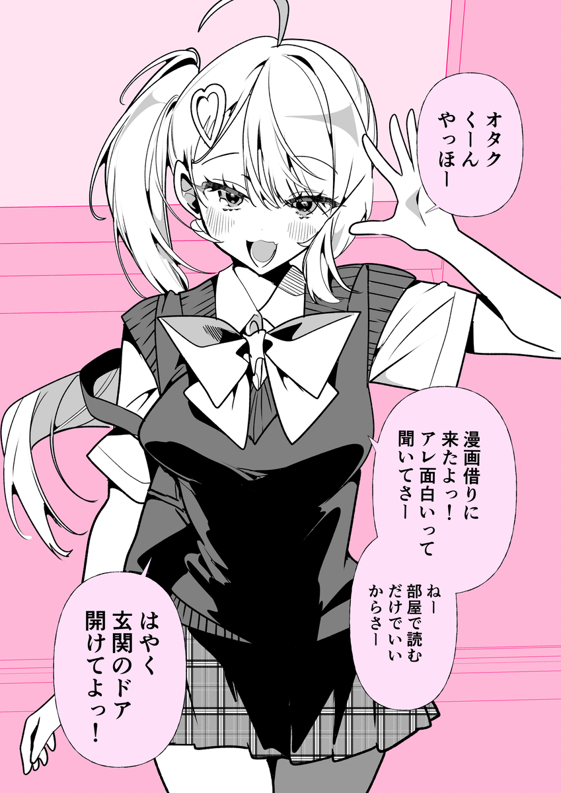
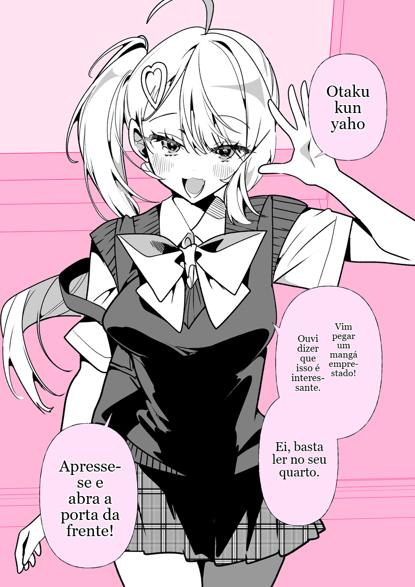
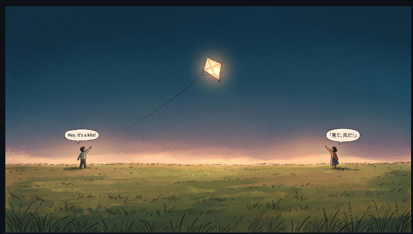

<div align="center">

[Português (Brasil)](README.md) | [简体中文](README.zh-CN.md) | [Tiếng Việt](README.vi.md) | [日本語](README.ja.md)

# 🪁 Manga Garden

### Leia mangás no seu idioma, direto no navegador.
**Sem Python • Sem servidores próprios • Tradução com IA no navegador**

🌐 **[Acesse o site do Manga Garden](https://manga-garden-translator.pages.dev/)**

[](https://chromewebstore.google.com/detail/pcaokchkdgnmfgjkljfpghlfohbdjcmj?utm_source=item-share-cb)
[](LICENSE)
[](manifest.json)
[](https://developer.mozilla.org/en-US/docs/Web/API/WebGPU_API)
[](package.json)

<br/>

<p align="center">
  <a href="https://chromewebstore.google.com/detail/pcaokchkdgnmfgjkljfpghlfohbdjcmj?utm_source=item-share-cb">
    
  </a>
  &nbsp;&nbsp;
  <a href="https://github.com/jacosncesar/MangaLumeTwo/releases/latest">
    
  </a>
</p>

<br/>

[](./README_images/Gemini_Generated_Image_f7lh52f7lh52f7lh.jpeg)

</div>

---

## 💡 Por que o Manga Garden?

Tradutores tradicionais de mangá exigem a instalação de scripts Python complexos e gigabytes de pacotes CUDA, ou o envio do seu histórico de leitura para servidores de terceiros.

**O Manga Garden muda isso.** É uma extensão leve para Chrome que executa modelos modernos de visão e linguagem **diretamente na placa gráfica, usando WebGPU**.

- ⚡ **Instalação simples:** instale a extensão e comece a ler. Para executar o projeto a partir do código-fonte, siga o guia de instalação abaixo.
- 🔒 **Processamento local quando possível:** o reconhecimento de texto (OCR) e a limpeza do fundo são executados no dispositivo. A imagem não é enviada ao provedor de tradução; o texto reconhecido pode ser enviado ao serviço de tradução escolhido.
- 🎨 **Restauração inteligente do fundo:** o preenchimento por IA remove o texto original preservando traços, retículas e texturas.
- ✍️ **Composição natural:** mede balões, equilibra as quebras de linha, ajusta o tamanho da fonte e adapta suas cores.
- 🗨️ **Ajuste inteligente de balões:** a detecção heurística e o YOLO neural ampliam áreas estreitas de leitura para evitar fontes excessivamente pequenas.
- 📜 **Suporte a tiras longas de webtoon:** traduz tiras com mais de 14.000 px usando divisão em blocos na memória, sem reduzir a resolução original.
- 🛠️ **Estúdio integrado:** corrija traduções, redimensione balões e ajuste a tipografia.

---

## 🖼️ Veja em ação

### Japonês → português
> *Fonte: [ilustração no Pixiv #144884723](https://www.pixiv.net/en/artworks/144884723)*

<div align="center">
<table>
  <tr>
    <th width="50%" align="center">Original em japonês</th>
    <th width="50%" align="center">Traduzido pelo Manga Garden</th>
  </tr>
  <tr>
    <td align="center">
      
    </td>
    <td align="center">
      
    </td>
  </tr>
</table>
</div>

<div align="center">
  
  <p><strong>Um agradecimento especial ao projeto <a href="https://github.com/Unheat/Kites">Kites</a>, à equipe <a href="https://github.com/Unheat">Unheat</a> e às pessoas colaboradoras.</strong><br />O trabalho de código aberto do Kites serviu de base para o Manga Garden; esta é uma homenagem à inspiração e à contribuição do projeto original.</p>
</div>

### Japonês → inglês
> *História: 佐藤さんは知っていた, de [@09ra_19ra](https://x.com/09ra_19ra)*

<div align="center">
<table>
  <tr>
    <th width="50%" align="center">Original em japonês</th>
    <th width="50%" align="center">Traduzido pelo Manga Garden</th>
  </tr>
  <tr>
    <td align="center">
      
    </td>
    <td align="center">
      
    </td>
  </tr>
</table>
</div>

### Japonês → vietnamita
> *Fonte: [ilustração no Pixiv #145272482](https://www.pixiv.net/en/artworks/145272482)*

<div align="center">
<table>
  <tr>
    <th width="50%" align="center">Original em japonês</th>
    <th width="50%" align="center">Traduzido pelo Manga Garden</th>
  </tr>
  <tr>
    <td align="center">
      
    </td>
    <td align="center">
      
    </td>
  </tr>
</table>
</div>

---

## 🖱️ Tradução instantânea na página

Passe o cursor sobre qualquer imagem de quadrinho no Twitter/X, Pixiv ou em sites de mangá. Um botão discreto aparece próximo à imagem; clique nele para traduzir o diálogo diretamente na página, sem copiar e colar.

<div align="center">
  
</div>

- 🖱️ **Passar o cursor:** traduza uma imagem instantaneamente.
- 📌 **Botões persistentes:** mantenha os botões de tradução visíveis nas imagens.
- 🚀 **Tradução automática:** traduza novas imagens enquanto percorre a página.
- ✂️ **Recorte da tela:** traduza elementos canvas protegidos, jogos WebGL ou áreas selecionadas com o menu do botão direito ou `Ctrl/Alt + Shift + X`.
- ⚡ **Atalhos de leitura:** pressione `F` para ver a imagem original, `Ctrl/Alt + Shift + Z` para traduzir a imagem sob o cursor e `Ctrl/Alt + Shift + M` para abrir o leitor de capítulos.
- 🎯 **Botão direito:** traduza imagens da Web pelo menu de contexto do navegador.

---

## 📖 Leitor de capítulos e varredura rápida

Leia capítulos inteiros de mangá ou webtoon em uma visualização sem distrações, com detecção automática de páginas, modo vertical contínuo, tradução em lote e exportação ZIP para leitura offline:

[](./README_images/UI-feature/reader.png)

- **Varredura rápida:** percorre automaticamente a página e coloca na fila as imagens carregadas sob demanda.
- **Modos flexíveis:** alterne entre tiras verticais contínuas, página única e página dupla.
- **Tradução em lote:** traduza o capítulo inteiro com um clique, acompanhando o progresso.
- **Exportação ZIP:** reúna as páginas traduzidas em um arquivo numerado para leitura offline.

---

## 🛠️ Estúdio integrado do Manga Garden

Quer revisar a tradução ou ajustar o texto? Abra o **Estúdio Manga Garden** em tela cheia pela extensão.

[](./README_images/UI-feature/studio-editor.png)

- **Edição direta:** clique duas vezes em um balão para editar o diálogo no próprio lugar, com ajuste tipográfico em tempo real.
- **Tela interativa:** arraste e redimensione balões usando alças de oito pontos.
- **Pincel de preenchimento por IA:** remova imperfeições, balões ou efeitos sonoros não traduzidos com pinceladas precisas.
- **Comparação lado a lado:** compare as versões original, limpa e diagramada.
- **Controle tipográfico:** ajuste fonte, cores, alinhamento e espaçamento entre linhas.
- **Exportação:** baixe páginas traduzidas e limpas na resolução original.

---

## 🎛️ Controles e predefinições da extensão

Personalize o idioma de destino, os modelos de OCR e os algoritmos de preenchimento pelo painel da extensão:

<div align="center">
<table>
  <tr>
    <th width="33%" align="center">Painel de controle</th>
    <th width="33%" align="center">Leitor e scanner de capítulos</th>
    <th width="34%" align="center">Configurações dos mecanismos</th>
  </tr>
  <tr>
    <td align="center">
      
    </td>
    <td align="center">
      
    </td>
    <td align="center">
      
    </td>
  </tr>
</table>
</div>

- **Glossário personalizado:** defina nomes de personagens, honoríficos e termos específicos para orientar os modelos locais e na nuvem.
- **Regras por site:** ative, desative ou configure seletores de elementos para cada domínio.

---

## 🧠 IA moderna

| Componente | Opções | Descrição |
| :--- | :--- | :--- |
| **Tradução** | **WebLLM** *(WebGPU local)*<br/>**Pool compartilhado na nuvem** *(100/dia)*<br/>**Google Translate**<br/>**API personalizada** *(OpenAI, Claude, Gemini)* | Execute modelos locais (Qwen 3.5, Qwen 3, Gemma 3, Llama 3.2), use o Google Translate, acesse o pool compartilhado ou conecte sua própria chave de API. |
| **Preenchimento** | **LaMa Manga** *(neural)*<br/>**AOT-GAN** *(neural rápido)*<br/>**Difusão de Telea** *(instantânea)*<br/>**Preenchimento simples** | Remove texto dentro dos limites dos caracteres para preservar a arte. |
| **OCR** | **PaddleOCR v3 – v6** | Detecção e reconhecimento multilíngue de texto, incluindo tiras longas de webtoon. |
| **Ajuste de balões** | **YOLO neural** *(WebGPU)*<br/>**Heurístico** *(instantâneo)*<br/>**MST clássico** | Amplia o espaço de diálogo nos balões para evitar fontes muito pequenas. |

---

### Opção 2: arquivo ZIP

1. Baixe o arquivo ZIP na página de [releases do repositório](https://github.com/jacosncesar/MangaLumeTwo/releases/latest), quando uma versão Manga Garden for publicada.
2. Extraia o `.zip` e carregue a pasta no Chrome por `chrome://extensions/` > **Modo do desenvolvedor** > **Carregar sem compactação**.

---

### Opção 3: compilar a partir do código-fonte

```bash
# 1. Clone o repositório com um diretório local chamado manga-garden
git clone https://github.com/jacosncesar/MangaLumeTwo.git manga-garden
cd manga-garden

# 2. Instale as dependências e compile a extensão
npm ci
npm run build
```

1. No Chrome, abra `chrome://extensions/`.
2. Ative o **Modo do desenvolvedor**.
3. Clique em **Carregar sem compactação** e selecione a pasta `dist/` gerada.
4. Fixe a extensão na barra do navegador.

---

## 🤝 Contribuição e documentação

Contribuições de pessoas desenvolvedoras, tradutoras e leitoras são bem-vindas.

- 📖 **[Central de documentação](docs/README.md)** — diagramas de arquitetura, especificações do pipeline e contratos de execução.
- 📐 **[Mapa interativo do pipeline](docs/workflow.html)** — visualização interativa das etapas de detecção, preenchimento e composição.
- 🛠️ **[Guia de contribuição](CONTRIBUTING.md)** — configuração do ambiente, execução de testes e envio de contribuições.

---

## 📜 Licença e agradecimentos

Este projeto é distribuído sob a **[GNU General Public License, versão 3 ou qualquer versão posterior](LICENSE)**.

O Manga Garden é um trabalho independente e modificado, baseado no [Kites](https://github.com/Unheat/Kites), projeto desenvolvido pela [Unheat](https://github.com/Unheat). O Manga Garden não é afiliado, patrocinado nem endossado pela Unheat. Seu nome, identidade visual, interface e modificações são distintos do projeto original. O código-fonte correspondente a cada versão do Manga Garden está disponível neste repositório, na tag daquela versão.

Este projeto agradece às iniciativas de código aberto que tornaram seu desenvolvimento possível:
- **[manga-image-translator (Cotrans)](https://github.com/zyddnys/manga-image-translator):** algoritmos de agrupamento espacial de texto e composição tipográfica.
- **[xianscan-rust](https://github.com/ArbenApura/xianscan-rust):** arquiteturas de preenchimento por blocos dinâmicos e filtros de ruído de OCR.
- **[PaddleOCR](https://github.com/PaddlePaddle/PaddleOCR):** modelos de alta velocidade para detecção de texto.
- **[@mlc-ai/web-llm](https://github.com/mlc-ai/web-llm):** ambiente WebGPU nativo do navegador para modelos de linguagem grandes.
- Agradecimento especial a [**Unheat**An Dang](https://github.com/Unheat).

---

<div align="center">
  <sub>Feito com ❤️ para quem gosta de mangás e quadrinhos.</sub>
</div>
