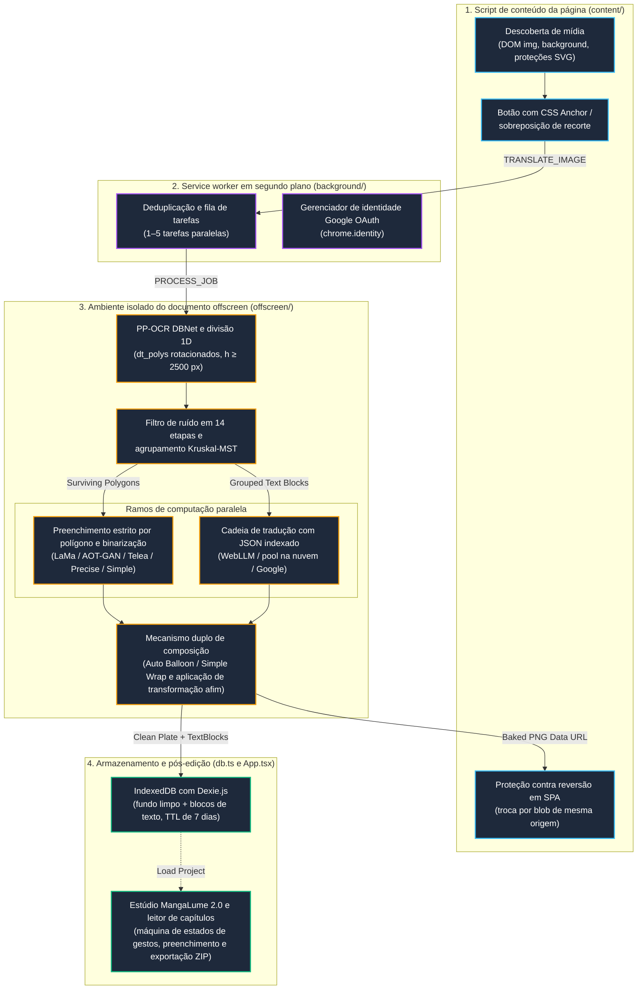

# Central de documentação técnica do MangaLume 2.0 🪁

Esta é a documentação de engenharia e arquitetura do **MangaLume 2.0**. Este diretório reúne especificações do sistema, guias de algoritmos, contratos de execução, registros de decisões de arquitetura (ADRs) e fluxos de trabalho de desenvolvimento.

## 🗺️ Visão geral do sistema e ciclo do pipeline

O diagrama abaixo mostra o ciclo completo de uma tarefa de tradução de imagem entre os diferentes contextos do Chrome Manifest V3:

---

## 🔍 Mapa interativo do pipeline (`workflow.html`)

Para explorar de forma interativa e detalhada todo o algoritmo de tradução:

👉 **[Abrir o fluxo interativo (`workflow.html`)](workflow.html)**

- **Sem dependências:** arquivo HTML independente, gerado pelo compilador **Archify** a partir de `docs/kites-workflow.json`.
- **Como abrir:** execute `open docs/workflow.html` ou abra o arquivo em um navegador.
- **Recursos:** cinco visualizações especializadas (fluxo completo, detalhes e filtros de OCR, algoritmo de busca de fontes, computação paralela de IA e armazenamento local), com painéis de inspeção interativos.

## 📖 Índice completo da documentação

### 🏛️ Arquitetura do sistema e subsistemas
1. **[System Architecture Overview](architecture/overview.md)**
   - Topologia da extensão Chrome Manifest V3 e limites entre contextos de execução
   - Mensagens do service worker e direcionamento explícito de chamadas RPC
   - Documento Offscreen persistente para WebGPU/WASM
   - Esquema de armazenamento IndexedDB (Dexie.js) e remoção por TTL de sete dias
2. **[Translation Pipeline & Algorithm Guide](architecture/pipeline.md)**
   - Divisão vertical 1D para webtoons altos ($h \ge 2500\text{ px}$)
   - Detecção de polígonos rotacionados com PaddleOCR DBNet e reconhecimento de recortes projetivos
   - Filtro geométrico e textual de ruído em 14 etapas
   - Agrupamento de balões por árvore geradora mínima de Kruskal (MST)
   - Ordem de leitura de quadros sensível ao idioma (`sort_regions` com agrupamento por faixas)
   - Preenchimento neural estrito por polígono (LaMa Manga e blocos dinâmicos de 64 px do AOT-GAN)
   - Protocolo JSON indexado para tradução de diálogos
   - Composição tipográfica com busca binária em quatro passagens, quebra equilibrada e posicionamento por matriz afim
3. **[Backend Worker da Cloudflare](architecture/backend-worker.md)**
   - Roteamento pelo gateway de borda (`api.12094852.xyz`) e integração com Cloudflare WAF
   - Verificação do token Google OAuth com anonimização criptográfica SHA-256
   - Durable Objects com SQLite: cotas móveis de 24 horas e otimização de gravação única
   - Encadeamento de provedores (Mistral, Groq, Google AI Studio, OpenRouter e Workers AI)
   - Timeouts adaptativos por EMA normalizada por tokens e pausas de circuit breaker
   - Fluxo de verificação em preview e staging antes da implantação
4. **[Script de conteúdo e subsistemas de mídia](architecture/content-script-and-media.md)**
   - Descoberta universal de mídia: abstração `MediaTarget` e resolução de superfícies ocultas (Twitter/X, Pixiv)
   - Filtragem de placeholders SVG (correção do bloqueio da fila da Issue #2 Roliascan)
   - CSS Anchor Positioning para botões de tradução na página, com proteção de 3 px contra corridas de hover
   - Troca de imagens em SPA e proteção de reversão com `MutationObserver` e controle recursivo `isSelfMutating`
   - Ferramenta de recorte da tela: captura da janela de visualização e normalização para telas Retina
5. **[Editor do Estúdio e arquitetura de composição tipográfica](architecture/studio-and-typesetting.md)**
   - Armazenamento de fundo limpo: separação não destrutiva entre a imagem de fundo e blocos de texto estruturados
   - Manipulação interativa de caixas delimitadoras com oito alças e normalização de zoom/pan
   - Catálogo de predefinições tipográficas (Wild Words, Anime Ace, Comic Hand etc.)
   - Amostragem de cor de fundo: detecção de contraste de luminância para texto claro em fundo escuro ou vice-versa
   - Ajuste por busca binária em quatro passagens, quebra equilibrada e exportação PNG sem perdas em escala 1:1
6. **[Modelos de IA, ambientes de execução e aceleração por hardware](architecture/models-and-runtimes.md)**
   - Detecção de hardware: shaders WebGPU JSEP com alternativa automática WASM SIMD
   - Categorias completas do PaddleOCR (`v6-small`, `v6-medium`, `v6-tiny`, `v5`, `v4`, `v3`)
   - Modelos de preenchimento: LaMa Manga (Fast Fourier Convolutions), AOT-GAN (Contextual Transformations) e Simple Adaptive Polarity
   - Mecanismos de tradução: WebLLM (MLC-AI WebGPU), pool compartilhado Cloudflare, Google Translate e API personalizada
   - Cache API persistente do navegador (`kites-model-cache`) e progresso monotônico de downloads

---

### 📋 Registros de decisões de arquitetura (ADRs)

As principais decisões técnicas e concessões de arquitetura estão documentadas em [`docs/decisions/`](decisions/):

- **[ADR-001: Documento Offscreen persistente para WebGPU e ambientes de IA](decisions/ADR-001-manifest-v3-offscreen-document-webgpu.md)** — Por que tarefas computacionalmente pesadas são executadas em um documento Offscreen, em vez de um service worker ou web worker.
- **[ADR-002: Contrato exclusivo de polígonos para mecanismos de preenchimento](decisions/ADR-002-polygon-only-inpainting-contract.md)** — Por que os mecanismos recebem máscaras poligonais dos caracteres, nunca caixas retangulares.
- **[ADR-003: Protocolo JSON indexado para tradução de diálogos](decisions/ADR-003-keyed-json-protocol-for-llm-translation.md)** — Por que o JSON indexado substituiu prompts com delimitadores na tradução por LLM.
- **[ADR-004: Divisão de canvas 1D na memória para webtoons longos](decisions/ADR-004-1d-in-memory-tiled-ocr-for-webtoons.md)** — Por que foi escolhida a divisão 1D em memória, em vez de separar o DOM ou rolar a janela de visualização.
- **[ADR-005: Arquitetura de armazenamento de fundo limpo com Dexie e IndexedDB](decisions/ADR-005-dexie-indexeddb-clean-plate-storage.md)** — Por que os fundos limpos são armazenados separadamente dos blocos de texto.
- **[ADR-006: Detecção híbrida de balões e partição conservadora de subcâmaras](decisions/ADR-006-hybrid-bubble-detection-and-conservative-subchamber-partitioning.md)** — Por que balões simples são expandidos até núcleos seguros e balões ambíguos retornam ao nível desativado.
- **[ADR-007: Preenchimento Telea FMM e catálogo centralizado](decisions/ADR-007-alexandru-telea-fmm-inpainting-and-centralized-catalog.md)** — Por que o Telea FMM nativo foi implementado e por que os níveis de preenchimento são centralizados.
- **[ADR-008: Arquitetura de composição dupla e invariantes de pós-processamento tipográfico](decisions/ADR-008-dual-typesetting-engine-and-advanced-typography-invariants.md)** — Por que Auto Balloon e Simple Wrap coexistem e como Kinsoku Shori, hifenização de sete letras e MeasureCache garantem a composição tipográfica.

---

### 💻 Guias de desenvolvimento e engenharia

- **[Configuração do ambiente](development/setup.md)** — Requisitos (Node.js 22.14 LTS), opções WebGPU do Chrome e compilação com Vite e CRXJS.
- **[Testes e critérios de qualidade](development/testing.md)** — Testes unitários automatizados (`npm test`), testes E2E no navegador e testes visuais independentes.
- **[Padrões e invariantes de código](development/coding-standards.md)** — Ciclo de vida do WebGPU, programação defensiva, requisitos de docstrings e prevenção de números e strings mágicos.
- **[Soluções alternativas e mitigações](development/workarounds.md)** — Mitigações documentadas para Vite 8/Rolldown, CRXJS 2.7.1, troca de imagens em SPA, restauração do estado WebGPU e estabilização do gradiente de Taylor do Telea.
- **[Plano de detecção de balões e composição tipográfica](development/bubble_detection_and_typesetting_upgrade_plan.md)** — Especificação dos níveis heurístico e YOLO neural, partição de subcâmaras e pesquisas futuras de segmentação.
- **[Plano de melhorias do ambiente do leitor e Estúdio](development/reader-studio-runtime-improvement-plan.md)** — Projeto arquitetural para máquinas de estados de gestos, feedback de inicialização de IA e limite de memória de capítulos.
- **[Plano de composição tipográfica e pós-processamento](development/typesetting-text-postprocess-plan.md)** — Especificações para normalização do Hangul, quebra de linha Kinsoku Shori, convenção da letra “I” em quadrinhos e memoização de layout com MeasureCache.

---

### 🗄️ Histórico de desenvolvimento

Os registros históricos de desenvolvimento, relatórios de pesquisa e diários de fase estão preservados em:
- **[`docs/dev-history/devlog/`](dev-history/devlog/)** — 49 registros detalhados sobre marcos de arquitetura, investigações de bugs e ajustes de desempenho.
- **[`docs/fullplan.md`](fullplan.md)** — Especificação geral do escopo e roteiro do projeto.
