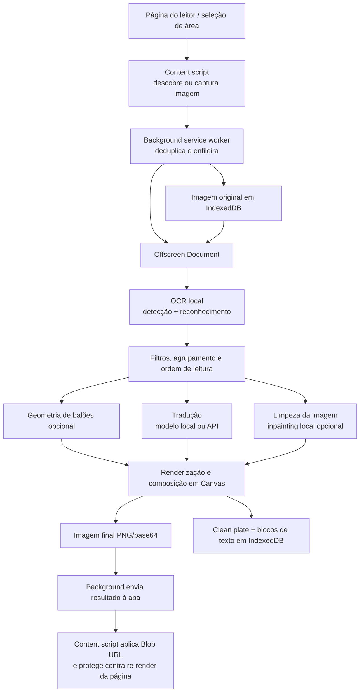

# Mapa funcional da aplicação

Este documento percorre o caminho real de uma tradução no Manga Garden: como a extensão encontra ou captura uma imagem, como o trabalho atravessa os contextos do Chrome, quais modelos e APIs participam e como o resultado volta à página. As contagens abaixo foram conferidas nos catálogos existentes no código; provedores externos podem alterar seus próprios limites e disponibilidade.

## Visão geral

Uma imagem comum segue os passos 1–9 abaixo. A seleção de área, o leitor de capítulos e o Studio entram por pontos diferentes, mas reutilizam boa parte do processamento do Offscreen Document.

## Fluxo detalhado

### 1. Configuração que determina o processamento

O popup guarda as preferências em `chrome.storage.local`. O estado inicial definido em `DEFAULT_POPUP_STATE` é:

| Configuração | Padrão |
|---|---|
| Idioma de origem | Detecção automática (`auto`) |
| Idioma de destino | Inglês (`en`) |
| Tradutor principal | Google Translate (`gg-translate`) |
| Cadeia de fallback | Vazia; o usuário pode adicionar mecanismos em ordem |
| OCR | PaddleOCR v6 Small (`v6-small`) |
| Limpeza de texto | Preenchimento simples (`simple`) |
| Detector de balões | Desligado (`off`) |
| Modo automático | Desligado |
| Concorrência salva | 1 |

O background e o Offscreen Document leem esse estado antes de processar o trabalho. As seleções de OCR, limpeza e tradução são independentes: trocar o tradutor, por exemplo, não troca o OCR.

### 2. Como a imagem é encontrada ou capturada

O content script, principalmente em [`mediaTargets.ts`](../../src/content/mediaTargets.ts) e [`index.tsx`](../../src/content/index.tsx), procura alvos de mídia no DOM. São considerados ``, imagens SVG, imagens de fundo CSS e canvas, além de fontes responsivas e atributos comuns de lazy-load (`data-src`, `data-original`, `data-lazy-src` e variantes).

- Alvos renderizados com menos de **150 × 150 px** não entram na descoberta normal.
- URLs que parecem placeholders, spinners, imagens 1×1 ou SVGs usados como carregamento são descartados.
- Para `srcset`, a extensão tenta escolher a variante de maior resolução.
- Em leitores com imagens sobrepostas ou elementos transparentes, a extensão associa a superfície visível à imagem real que deve ser lida.
- Seletores de site configurados pelo usuário podem complementar a descoberta.

Há três maneiras usuais de iniciar:

1. **Manual:** botão de tradução em cima da imagem, conforme o modo de interação configurado.
2. **Automática:** `IntersectionObserver` detecta imagens que entram na área visível e solicita sua tradução.
3. **Lote/leitor de capítulo:** o scanner reúne páginas e as envia à fila em sequência.

Para conteúdo que não pode ser lido diretamente como imagem da página, a ferramenta de recorte captura a aba visível e recorta a área selecionada. Esse caminho também grava um `Blob` local e usa a mesma fila de processamento.

### 3. Fila, download dos bytes e comunicação entre contextos

O content script envia `TRANSLATE_IMAGE` ao background. O background:

1. verifica se a mesma URL já está em estado `queued`, `downloading` ou `processing`;
2. grava o trabalho em `translationJobs` no IndexedDB (Dexie);
3. baixa os bytes da URL original e grava o `Blob` em `images`;
4. quando necessário, usa uma regra temporária de `declarativeNetRequest` para fornecer o `Referer` da página ao CDN;
5. envia `PROCESS_JOB` ao Offscreen Document, que responde depois de completar o pipeline.

Os recortes já chegam como dados capturados e são gravados como Blob antes de entrar no mesmo pipeline. O IndexedDB é local; a imagem original não é enviada ao provedor de tradução.

**Limite importante:** embora exista uma configuração de concorrência e a fila aceite trabalhos pendentes, o processador atual executa **um pipeline de imagem por vez** no Offscreen Document. Isso evita concorrência em sessões WebGPU/ONNX. O valor de concorrência também participa do limite de trabalhos pendentes da solicitação normal; o painel de lote tem capacidade própria de até 100 pendências.

### 4. OCR: localizar e reconhecer o texto

O [`PipelineOrchestrator`](../../src/offscreen/services/PipelineOrchestrator.ts) recupera o Blob do IndexedDB, decodifica suas dimensões e chama `OcrManager.processImage`. O OCR roda no navegador com PaddleOCR e ONNX Runtime Web, usando WebGPU quando habilitado e disponível e WASM/CPU como alternativa.

O trabalho do OCR tem duas partes:

1. **Detecção:** identifica regiões de texto e produz polígonos/pontos e confiança.
2. **Reconhecimento:** corrige a perspectiva de cada região e converte a imagem em caracteres.

Para imagens muito altas, o OCR divide a imagem em faixas verticais sobrepostas, reconhece cada faixa e remapeia as coordenadas para a página. O código ativa o caminho de tiling a partir de **2.500 px de altura**; as faixas têm 1.000 px e passo de 700 px, portanto há sobreposição para deduplicar detecções de fronteira.

O resultado não é apenas uma lista de frases: cada item mantém texto original, polígono, caixa, direção horizontal/vertical e, quando disponível, ângulo, tamanho estimado, confiança e número de linhas.

#### Catálogo de OCR atual: 10 opções

`ocrRegistry.ts` contém estes identificadores:

`v6-small`, `v6-medium`, `v6-tiny`, `v5-mobile`, `v5-server`, `v5-en-mobile`, `v4-mobile`, `v4-server`, `v3-mobile` e `v3-japanese-mobile`.

Os pesos ONNX e dicionários são baixados sob demanda dos endereços definidos no registro, servidos por `media.githubusercontent.com` e `raw.githubusercontent.com`; o cache de modelos evita baixar novamente os mesmos arquivos.

### 5. Filtragem, agrupamento e leitura

Antes de traduzir, `OcrManager` limpa e organiza as detecções. Entre as operações estão remoção de ruído e caixas inválidas, deduplicação de detecções sobrepostas, filtragem sensível ao idioma e à geometria da página, agrupamento de linhas que pertencem ao mesmo bloco e ordenação de leitura.

Isso é importante porque uma página pode conter várias detecções OCR para uma única fala. O tradutor recebe blocos de texto agrupados, não necessariamente uma requisição separada por linha detectada. Linhas CJK são concatenadas sem espaço quando apropriado; textos com alfabeto latino podem manter espaços. A ordenação considera direção de leitura da página.

Se nenhum texto for reconhecido, a tarefa termina sem tradução: a imagem original é gravada como resultado e devolvida sem alterações.

### 6. Geometria dos balões (opcional)

Quando o modo de balões está ativo, `BubbleManager` e `BubbleLayoutService` procuram a área útil do balão para oferecer uma caixa de composição mais legível. O modo pode ser:

- `off`: não extrai geometria de balões;
- `heuristic`: extrator local sem pesos;
- `neural`: detector neural;
- `neural-mask`: modo neural com máscaras/formas.

O modo padrão é `off`. A geometria pode ampliar ou ajustar a caixa usada para compor a tradução, mas não substitui o OCR. Se a extração falhar, o pipeline volta às caixas de texto reconhecidas.

### 7. Tradução e limpeza da imagem

Depois de agrupar os textos, o pipeline inicia dois ramos em paralelo:

- **Tradução:** `TranslationManager.processTranslation(...)`.
- **Limpeza/inpainting:** `InpaintManager.eraseText(...)`, quando a opção não é `none` e há polígonos para limpar.

O processamento paralelo reduz o tempo total: a etapa termina quando os dois ramos terminam. O inpainting recebe máscaras/polígonos do texto e executa localmente; os pesos neurais opcionais são baixados antes do uso e armazenados em cache.

#### Opções de limpeza atuais: 6

| ID | O que faz |
|---|---|
| `none` | Não tenta apagar o texto original. |
| `simple` | Preenchimento local simples por cor/polaridade; não precisa de modelo neural. |
| `stroke-fill` | Remove principalmente os traços identificados do texto. |
| `telea` | Difusão local pelo método Fast Marching, implementada no projeto. |
| `lama-manga` | Modelo LaMa para mangá, com recortes locais dimensionados em múltiplos de 64 px. |
| `aotgan` | Modelo AOT-GAN para reconstrução de fundos/texturas mais difíceis. |

Se LaMa ou AOT-GAN estiver selecionado, mas os respectivos arquivos ainda não estiverem no cache, o pipeline escolhe `simple` em vez de iniciar um download implícito durante essa tarefa. Se a limpeza falhar, mantém a imagem original como fundo. O identificador legado `aot` é normalizado para `aotgan`.

#### Como o lote de textos é preparado

Os mecanismos LLM compartilham `BaseLlmTranslationEngine`:

- linhas vazias e compostas apenas de pontuação/símbolos são passadas adiante sem chamada ao modelo;
- os textos são organizados em blocos identificados (`b0`, `b1`, …) e enviados com um protocolo JSON para preservar a correspondência entre entrada e saída;
- glossário ativo é anexado ao pedido;
- a saída é limpa de cercas Markdown, aspas externas e rótulos como “Translation:”;
- se faltarem resultados, a implementação usa sua política de tolerância/retry e pode manter o texto de origem para não perder a posição do bloco.

Os tamanhos de lote variam conforme o mecanismo: **15 blocos** para WebLLM e Cloudflare; **25** para API personalizada; o Google agrupa por limite de caracteres de aproximadamente 1.800 caracteres por pedido. Portanto, uma página não equivale sempre a uma única chamada.

O fallback no cliente não é uma lista global fixa: `TranslationManager` tenta primeiro `activeEngineId` e, se esse mecanismo lançar erro, percorre os IDs em `fallbackChain` na ordem definida pelo usuário. A cascata de provedores internos do Cloud Shared Pool é independente. Um detalhe importante: o mecanismo Google trata falhas por bloco retornando o texto original em alguns casos; como não lança erro nesses casos, o `TranslationManager` considera o mecanismo concluído e não avança para o próximo fallback.

### 8. Quais tradutores existem e quais APIs são chamadas

`ModelRegistry` expõe dois mecanismos de rede integrados e os modelos WebLLM listados em `models-registry.json`.

| Caminho selecionado | Chamada efetiva | Dados enviados / observações |
|---|---|---|
| WebLLM local | `@mlc-ai/web-llm` no Offscreen Document | O texto é inferido no próprio navegador usando WebGPU. Não há chamada remota para traduzir o texto; o primeiro uso pode baixar os pesos do modelo. Requer WebGPU e o modelo baixado. |
| Google Translate | `https://translate.googleapis.com/translate_a/single` | Pedido GET para texto de até 600 caracteres ou POST para textos maiores; tenta os clientes `dict-chrome-ex` e `gtx`. Não requer chave configurada na extensão. |
| Cloud Shared Pool | `POST https://api.12094852.xyz/v1/chat/completions` | Envia prompt e textos, não a imagem. Exige conta Google conectada; o token é obtido via `chrome.identity`/background. O Worker distribui a solicitação entre seus provedores. |
| API personalizada — OpenAI | `POST https://api.openai.com/v1/chat/completions` | Cliente OpenAI do Vercel AI SDK; modelo e chave vêm da configuração do usuário. |
| API personalizada — OpenAI-compatible | `POST {baseUrl}/chat/completions` | URL base e chave são fornecidas pelo usuário; a URL precisa ser HTTPS, exceto HTTP para localhost. |
| API personalizada — Gemini | `POST https://generativelanguage.googleapis.com/v1beta/models/{model}:generateContent` | Cliente Google Generative AI do Vercel AI SDK; modelo e chave vêm da configuração do usuário. |
| API personalizada — Claude | `POST https://api.anthropic.com/v1/messages` | Cliente Anthropic do Vercel AI SDK; modelo e chave vêm da configuração do usuário. |

As APIs personalizadas são testadas no momento do cadastro e suas credenciais são armazenadas na configuração local da extensão. A interface tem quatro tipos de provedor; o código não define um número máximo de configurações personalizadas.

#### O que o Worker do Cloud Shared Pool chama por trás

O endpoint do Worker é OpenAI-compatible. Depois da validação e da cota, `SharedPoolDO` seleciona provedores habilitados por prioridade crescente e tenta o próximo se o anterior falhar ou estiver limitado. A ordem atual no registro é:

1. Google AI Studio — Gemma 4 26B (`generativelanguage.googleapis.com`, `generateContent`);
2. Google AI Studio — Gemma 4 31B (`generativelanguage.googleapis.com`, `generateContent`);
3. Groq — Qwen 3.8 27B (`api.groq.com/openai/v1/chat/completions`);
4. Groq — GPT OSS 120B;
5. Groq — GPT OSS 20B;
6. Groq — Qwen 3.6 27B;
7. Mistral — Ministral 3B (`api.mistral.ai/v1/chat/completions`);
8. OpenRouter Free (`openrouter.ai/api/v1/chat/completions`);
9. Cloudflare Workers AI — Llama 3.2 1B, executado pelo binding nativo `env.AI` (sem chamada HTTP do Worker para um endpoint externo).

Esses nove provedores são a cascata interna do serviço; eles **não** são nove opções separadas no seletor da extensão. A rota pública para a extensão continua sendo o Worker Manga Garden.

### 9. Composição e retorno do resultado

Quando texto traduzido e imagem limpa estão prontos:

1. o Offscreen Document cria um `OffscreenCanvas` do tamanho original da imagem;
2. desenha a imagem limpa como fundo;
3. espera as fontes disponíveis e compõe os blocos traduzidos com o renderizador de texto, respeitando caixas/polígonos, direção, ângulo, fonte, cor, contorno e ajuste de linhas;
4. produz um PNG e o codifica como Data URL/base64 para enviar de volta à aba;
5. grava no IndexedDB o **clean plate** (imagem limpa sem texto traduzido incorporado) e os blocos estruturados (`originalText`, `translatedText`, posições, tamanho, fonte, cores e demais propriedades de composição);
6. marca o trabalho como concluído e notifica o background.

O background envia `IMAGE_TRANSLATED` ao content script. A imagem final recebida vira um Blob URL local; antes de aplicá-la à página, o content script limpa `srcset`. Um `MutationObserver` pode reaplicar a imagem traduzida caso um framework SPA restaure o `src` original. O Studio usa os dados estruturados e o clean plate para permitir edição/exportação sem perder a imagem original.

Se a tradução falha por completo, `PipelineOrchestrator` preserva os textos de origem para a composição, de modo que o pipeline ainda consiga retornar uma imagem. Isso é diferente de uma conclusão sem texto OCR, que devolve a imagem original sem composição.

## Quantas traduções estão disponíveis?

“Quantidade” pode significar modelos, provedores, pares linguísticos ou cota de uso. No estado atual do código:

### Mecanismos de tradução

- **57 modelos locais WebLLM** no catálogo estático `src/shared/models-registry.json`.
- **2 mecanismos integrados de rede:** Google Translate e Cloud Shared Pool.
- **Total fixo no catálogo do seletor: 59 mecanismos** (57 locais + 2 integrados), antes de adicionar APIs próprias.
- **+ N configurações personalizadas:** o usuário pode cadastrar OpenAI, OpenAI-compatible, Gemini e Claude. Não há limite explícito de quantidade no código; cada configuração usa o modelo indicado pelo usuário.

“Estar no catálogo” não significa que o peso já esteja instalado ou que o hardware tenha memória suficiente. Modelos locais podem exigir download e WebGPU; o seletor pode desabilitar um modelo que ainda não foi baixado ou que não pode ser usado no dispositivo. O Cloud Shared Pool precisa de login Google.

### Idiomas e combinações

`LANGUAGES` oferece **58 idiomas nomeados** para origem/destino e uma opção extra de **detecção automática**, válida somente como idioma de origem. Assim, os seletores representam **59 opções de origem × 58 destinos = 3.422 combinações configuráveis**. Esse é o produto das opções da interface, não uma garantia de que todo modelo suporte todos os pares com a mesma qualidade.

Idiomas nomeados no catálogo: africâner (`af`), albanês (`sq`), árabe (`ar`), armênio (`hy`), bengali (`bn`), búlgaro (`bg`), catalão (`ca`), chinês simplificado (`zh-CN`), chinês tradicional (`zh-TW`), croata (`hr`), tcheco (`cs`), dinamarquês (`da`), neerlandês (`nl`), inglês (`en`), estoniano (`et`), filipino (`tl`), finlandês (`fi`), francês (`fr`), alemão (`de`), grego (`el`), gujarati (`gu`), hebraico (`he`), hindi (`hi`), húngaro (`hu`), islandês (`is`), indonésio (`id`), italiano (`it`), japonês (`ja`), kannada (`kn`), khmer (`km`), coreano (`ko`), letão (`lv`), lituano (`lt`), malaio (`ms`), malaiala (`ml`), marata (`mr`), nepalês (`ne`), norueguês (`no`), persa (`fa`), polonês (`pl`), português (`pt`), punjabi (`pa`), romeno (`ro`), russo (`ru`), sérvio (`sr`), eslovaco (`sk`), esloveno (`sl`), espanhol (`es`), suaíli (`sw`), sueco (`sv`), tâmil (`ta`), telugu (`te`), tailandês (`th`), turco (`tr`), ucraniano (`uk`), urdu (`ur`), vietnamita (`vi`) e galês (`cy`).

### Cota do Cloud Shared Pool

O Worker atual define **100 chamadas de tradução válidas por usuário em uma janela móvel de 24 horas**, iniciada na primeira chamada, e um teto global de **70.000 traduções por dia**. O painel pode consultar `GET https://api.12094852.xyz/v1/quota`; essa consulta é somente leitura.

Essa cota do Worker contabiliza chamadas ao endpoint, **não páginas nem balões**. WebLLM e Cloudflare trabalham em lotes de até 15 blocos: uma página com mais blocos pode gerar mais de uma chamada; uma página pequena pode gerar uma. A cota é consumida antes das tentativas de provedores internos; uma chamada válida que depois não consegue um provedor pode ainda usar uma unidade. Cotas, preços e limites de OpenAI, Gemini, Claude, Google Translate e APIs compatíveis são próprios de cada serviço e não são definidos pelo Manga Garden.

## Chamadas externas auxiliares

Essas chamadas apoiam o processamento, mas não são chamadas de tradução do texto da página:

| Recurso | Endereços usados pelo código | Quando |
|---|---|---|
| Verificação de identidade do Worker | `https://www.googleapis.com/oauth2/v3/certs` | O Worker valida as chaves públicas usadas para verificar o token Google. |
| Modelos e dicionários OCR | `media.githubusercontent.com` e `raw.githubusercontent.com` | Quando o arquivo do tier de OCR selecionado ainda não está no cache. |
| Pesos de inpainting | `https://huggingface.co/.../resolve/main/...` | Quando o usuário inicia o download/uso de LaMa ou AOT-GAN. |
| Modelos WebLLM | Distribuição e cache gerenciados por `@mlc-ai/web-llm` | Ao inicializar pela primeira vez um modelo local não baixado. O texto de tradução continua sendo inferido no dispositivo. |

No fluxo de tradução em nuvem, o payload contém os textos reconhecidos e o contexto de prompt; o Blob da página permanece no navegador. A imagem é baixada do site de origem para o processamento local, mas não é enviada ao endpoint de tradução.

## Arquivos-fonte de referência

- Descoberta e substituição na página: [`src/content/mediaTargets.ts`](../../src/content/mediaTargets.ts), [`src/content/index.tsx`](../../src/content/index.tsx).
- Fila, download da imagem, RPC e retorno: [`src/background/index.ts`](../../src/background/index.ts).
- Pipeline principal, limpeza, composição e persistência: [`src/offscreen/services/PipelineOrchestrator.ts`](../../src/offscreen/services/PipelineOrchestrator.ts).
- OCR, filtro e montagem de blocos: [`src/offscreen/services/OcrManager.ts`](../../src/offscreen/services/OcrManager.ts).
- Seleção/fallback de tradutores: [`src/offscreen/services/TranslationManager.ts`](../../src/offscreen/services/TranslationManager.ts).
- Protocolo LLM e lote: [`src/offscreen/engines/translation/BaseLlmTranslationEngine.ts`](../../src/offscreen/engines/translation/BaseLlmTranslationEngine.ts).
- Endpoints de tradução: [`GoogleTranslateEngine.ts`](../../src/offscreen/engines/translation/GoogleTranslateEngine.ts), [`CloudflareTranslateEngine.ts`](../../src/offscreen/engines/translation/CloudflareTranslateEngine.ts), [`CustomApiEngine.ts`](../../src/offscreen/engines/translation/CustomApiEngine.ts).
- Contagens/catálogos: [`ModelRegistry.ts`](../../src/popup/services/ModelRegistry.ts), [`models-registry.json`](../../src/shared/models-registry.json), [`LanguageRegistry.ts`](../../src/shared/utils/LanguageRegistry.ts), [`ocrRegistry.ts`](../../src/offscreen/engines/ocr/ocrRegistry.ts), [`inpaintTiers.ts`](../../src/shared/inpaintTiers.ts).
- Serviço e cascata do pool: [`worker/src/index.ts`](../../worker/src/index.ts), [`worker/src/config/providers.ts`](../../worker/src/config/providers.ts), [`worker/src/durable/SharedPoolDO.ts`](../../worker/src/durable/SharedPoolDO.ts).
